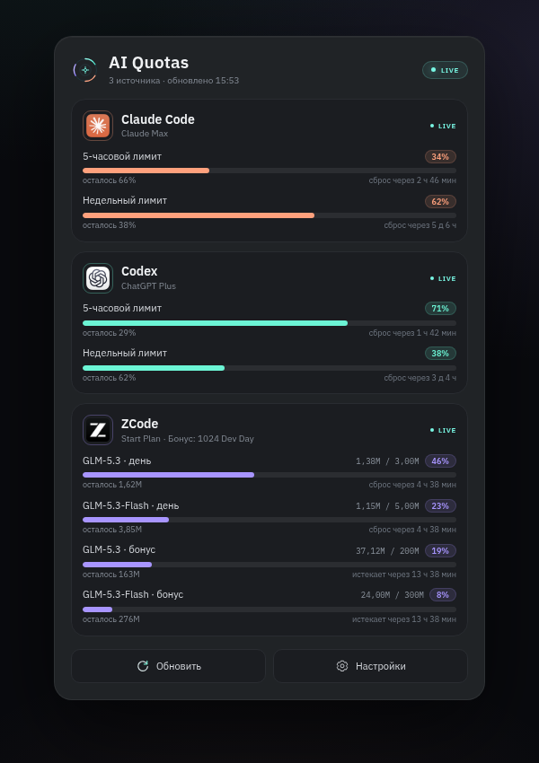

# Quota Grid

Quota Grid показывает лимиты локально установленных AI-инструментов. Для KDE Plasma 6 есть нативный виджет в панели, а для остальных окружений — локальный веб-дашборд с тем же дизайном. Обновление идёт в фоне, поэтому цифры остаются актуальными, даже когда интерфейс закрыт. При старте нового окна лимита приходит системное уведомление.

> Версия 1.1.0. Проект использует локальные сессии и неофициальные usage-endpoint'ы, поэтому поведение провайдеров может меняться без предупреждения.

## Возможности

- Панельный виджет KDE Plasma 6: компактная капсула с кольцами использования и попап-дашборд с карточками провайдеров.
- Кросс-десктопный веб-дашборд: открывается в любом браузере на GNOME, XFCE, Cinnamon, MATE, LXQt, Budgie и других окружениях. Работает на X11 и Wayland.
- Claude Code, Codex и ZCode: 5-часовые и недельные окна, а для ZCode — дневные лимиты и отдельные бонусные пакеты.
- Обновление в фоне через `systemd --user` или XDG autostart.
- Системные уведомления KDE/GNOME/XFCE через `notify-send` при сбросе окна.
- Статусы `LIVE`, `LOW`, `LIMIT`, `AUTH`, `PAUSED`, `STALE`.
- CLI и JSON-вывод для интеграций.

## Как это выглядит

### KDE Plasma 6

<p align="center">
  
</p>

<p align="center"><sub>Попап: карточки провайдеров, проценты, время сброса и отдельные бонусные пакеты ZCode.</sub></p>

<p align="center">
  
</p>

<p align="center"><sub>Подсказка компактного индикатора при наведении в панели Plasma.</sub></p>

### Веб-дашборд для других рабочих столов

<p align="center">
  
</p>

<p align="center"><sub>Локальный веб-дашборд с демо-данными. Запускается через ярлык Quota Grid или команду <code>quota-manager ui</code>.</sub></p>

## Совместимость

| Окружение | Интерфейс | Статус |
| --- | --- | --- |
| KDE Plasma 6 на Wayland | виджет в панели + веб-дашборд | протестировано на Kubuntu 26.04, Plasma 6.6.6 |
| KDE Plasma 6 на X11 | виджет в панели + веб-дашборд | виджет использует стандартные Plasma/QML API; отдельно на X11 не тестировался |
| GNOME, XFCE, Cinnamon, MATE, LXQt, Budgie | веб-дашборд + уведомления | веб-интерфейс протестирован в Chrome на Kubuntu; другие окружения не тестировались |
| Ubuntu 22.04+ / Debian 12+ | `.deb`: веб-дашборд, виджет при наличии Plasma 6 | пакет собирается из репозитория; проверьте установку на своей системе |
| Плазма 5 | не поддерживается | для неё нужен отдельный порт |

Требования:

- Linux с Python 3.10+;
- браузер и `xdg-utils` для веб-дашборда;
- `notify-send` для системных уведомлений (пакет `libnotify-bin` в Debian/Ubuntu);
- `python3-cryptography` для ZCode;
- `systemd --user` желателен, но не обязателен: установщик из исходников умеет использовать XDG autostart;
- для виджета — KDE Plasma 6 и `kpackagetool6`;
- для задуманной типографики желательны шрифты IBM Plex Sans и IBM Plex Mono, но без них используется системный fallback.

Интерфейс сейчас на русском языке. Проект не является расширением GNOME Shell: в GNOME квоты открываются как отдельное приложение/вкладка браузера, а уведомления приходят системные.

## Установка

### Ubuntu / Debian: готовый `.deb`

Скачайте `quota-grid_1.1.0_all.deb` из [GitHub Releases](https://github.com/dengabrielyan/quota-grid/releases) и установите:

```bash
sudo apt install ./quota-grid_1.1.0_all.deb
```

`apt` сам подтянет зависимости. Пакет не подписан и не входит в официальные репозитории Ubuntu/Debian — это сборка из GitHub Releases. После установки:

- в меню приложений появится **Quota Grid** — откройте веб-дашборд;
- на KDE Plasma 6 виджет можно добавить через стандартный выбор виджетов;
- фоновый сборщик запускается при следующем входе через XDG autostart; до перезахода можно выполнить `quota-manager refresh` вручную.

Пакет устанавливает и веб-интерфейс, и Plasma-виджет. Автозапуск можно отключить в системных настройках автозапуска рабочего стола.

### Любой Linux: из исходников

Зависимости для Debian/Ubuntu:

```bash
sudo apt install python3 python3-cryptography libnotify-bin xdg-utils fonts-ibm-plex
```

Для Fedora/Arch/openSUSE имена пакетов отличаются; нужны Python 3.10+, cryptography, libnotify/notify-send, xdg-utils и, при желании, шрифты IBM Plex. Установщик проверит ключевые зависимости и подскажет, чего не хватает.

```bash
git clone https://github.com/dengabrielyan/quota-grid.git
cd quota-grid
./install.sh
```

Установщик сам определяет окружение:

- если найден KDE Plasma 6 — устанавливает виджет;
- если Plasma нет — оставляет только веб-дашборд и ярлык приложения;
- если доступен `systemd --user` — ставит фоновый сервис;
- иначе создаёт XDG autostart для демона.

Дополнительные параметры:

```bash
./install.sh --add-to-panel   # сразу добавить виджет в панель Plasma
./install.sh --no-service     # не запускать фоновый сборщик
```

Установка идёт в домашний каталог пользователя и не требует `sudo`:

- `~/.local/lib/quota-manager` — backend;
- `~/.local/bin/quota-manager` — CLI;
- `~/.local/share/applications/quota-grid.desktop` — ярлык **Quota Grid**;
- `~/.local/share/plasma/plasmoids/org.kde.quota-grid` — виджет (если есть Plasma);
- `~/.local/share/icons/hicolor/scalable/apps/quota-grid.svg` — иконка;
- systemd-сервис или XDG autostart — фоновое обновление.

## Запуск

В меню приложений выберите **Quota Grid**. Откроется локальный веб-дашборд; он работает, пока открыта вкладка, и останавливается через 5 минут без запросов. Если браузер не открылся автоматически:

```bash
quota-manager ui
quota-manager ui --no-browser --port 8765
```

Веб-сервер слушает только `127.0.0.1` и использует случайный порт и одноразовый токен. Данные не доступны из локальной сети.

## Провайдеры

Приложение использует уже существующие локальные сессии:

| Источник | Что нужно | Что читается |
| --- | --- | --- |
| **Claude Code** | установленный и авторизованный `claude` | `~/.claude/.credentials.json` и OAuth usage endpoint |
| **Codex CLI** | установленный и авторизованный `codex` | официальный локальный JSON-RPC `codex app-server` |
| **ZCode** | ZCode Desktop с активной сессией z.ai | `~/.zcode/v2/credentials.json` и billing API |

Claude Code использует OAuth с ротацией refresh-токена. Quota Grid при необходимости обновляет access-токен и **атомарно** сохраняет новую пару в файл Claude Code, сохраняя остальные поля файла и права `0600`. Если сессия отозвана, выполните:

```bash
claude auth login
```

Для Codex при истечении сессии выполните `codex login`; для ZCode — войдите в приложение заново. В интерфейсе такие состояния показываются как `AUTH`.

## CLI

```bash
quota-manager status          # таблица из кэша, без сети
quota-manager status --json   # JSON (используется интерфейсами)
quota-manager refresh         # опросить все источники сейчас
quota-manager refresh --json  # JSON после обновления
quota-manager ui              # локальный веб-дашборд
quota-manager doctor          # диагностика источников и зависимостей
quota-manager notify-test     # проверить системные уведомления
quota-manager settings        # создать и открыть config.json
quota-manager daemon          # фоновый сборщик
systemctl --user status quota-manager
journalctl --user -u quota-manager -f
```

Кнопка **Обновить** в веб-дашборде запускает `refresh`. Обычно обновление идёт автоматически раз в 5 минут.

## Уведомления

Фоновый сборщик отправляет одно системное уведомление, когда появляется новое окно лимита. Первый запуск только запоминает текущие окна и не создаёт ложных уведомлений. Проверка:

```bash
quota-manager notify-test
```

В KDE и других окружениях уведомления зависят от системного демона уведомлений и наличия `notify-send`. Для установки из исходников используется `systemd --user`, а при его отсутствии — XDG autostart. В `.deb` используется XDG autostart для всех пользователей.

## Конфигурация

Создайте `~/.config/quota-manager/config.json`:

```json
{
  "refresh_interval_seconds": 300,
  "notifications": true
}
```

Интервал ограничен диапазоном 60–3600 секунд. После изменения интервала перезапустите фоновый сборщик:

```bash
systemctl --user restart quota-manager
```

## Приватность и безопасность

Данные не отправляются в сторонние сервисы. Приложение не содержит телеметрии. OAuth-токены никогда не попадают в кэш, журналы или вызовы интерфейсов. Кэш и состояние имеют права `0600`, каталоги — `0700`.

Веб-дашборд:

- слушает только `127.0.0.1`;
- проверяет заголовок `Host`, чтобы исключить DNS-rebinding;
- требует случайный токен для всех API-запросов;
- отдаёт статические файлы по белому списку и использует CSP;
- не принимает запросы с других сайтов.

Сообщения об ошибках проходят редактирование секретов перед записью в журнал. Запись настроек и запуск обновления из веб-интерфейса защищены тем же локальным токеном.

## Ограничения

- Anthropic и ZCode не публикуют контракты именно этих usage-endpoint'ов; при изменениях на стороне сервисов провайдер может временно показывать `ERROR`.
- Codex app-server помечен как экспериментальный самим Codex CLI.
- ZCode поддерживает активный провайдер `z.ai`; корпоративные конфигурации bigmodel могут отличаться. У текущего тарифа Start Plan нет 5-часового или недельного окна, поэтому виджет честно показывает дневные лимиты и бонусные пакеты.
- OpenCode, Gemini CLI и другие инструменты не добавлены, пока у них нет доступного локального источника квот.
- GNOME Shell не имеет нативного верхнего индикатора: используется веб-дашборд и системные уведомления. Для верхней панели GNOME потребуется отдельное расширение.
- Оформление попапа Plasma (без системной рамки, отступ 24 px от края) проверено на Plasma 6.6. На других версиях Plasma рамка может выглядеть иначе; функциональность от этого не зависит.
- `.deb` не входит в официальные репозитории и не подписан; это артефакт GitHub Releases.

## Удаление

Для установки из исходников:

```bash
./uninstall.sh          # удалить приложение, сохранить кэш
./uninstall.sh --purge  # удалить всё, включая кэш
```

Для `.deb`:

```bash
sudo apt remove quota-grid
```

## Разработка

```bash
python3 -m unittest discover -s tests -v
./packaging/build-deb.sh
```

19 тестов не обращаются к сети и не требуют реальных токенов. Они проверяют парсинг окон, выбор дневных и бонусных пакетов ZCode, редактирование секретов, детектор сбросов, локальный веб-сервер и защиту API.

```text
quota_manager/                 Python backend, провайдеры и локальный веб-сервер
quota_manager/webui/           HTML/CSS/JS веб-дашборда
plasma/org.kde.quota-grid/     Plasma 6 plasmoid (QML)
docs/screenshots/              скриншоты интерфейсов
packaging/build-deb.sh         сборка .deb без sudo
systemd/                       user service
tests/                         unit-тесты backend и веб-сервера
install.sh / uninstall.sh      установка в домашний каталог
```

Сборка `.deb` требует `dpkg-deb` (пакет `dpkg-dev` в Debian/Ubuntu). Результат появляется в `dist/`.

## Логотипы

Иконки провайдеров взяты из локально установленных приложений Claude, ChatGPT/OpenAI и ZCode и используются только для идентификации соответствующих сервисов. Права на логотипы принадлежат их владельцам; проект не аффилирован с Anthropic, OpenAI или ZCode.

## English summary

Quota Grid shows AI coding-tool limits from locally installed sessions of Claude Code, Codex and ZCode. On KDE Plasma 6 it provides a native panel widget; on other Linux desktops it provides a local web dashboard that works on X11 and Wayland. A user service or XDG autostart refreshes quotas in the background, and desktop notifications announce reset limit windows. Requirements: Linux, Python 3.10+, a browser for the cross-desktop UI, and authorized provider apps; `python3-cryptography` is needed for ZCode. The UI is currently in Russian. Tested on Kubuntu 26.04 with Plasma 6.6.6 on Wayland. Build a Debian package with `./packaging/build-deb.sh`, or install from source with `./install.sh`.

## Лицензия

MIT.
