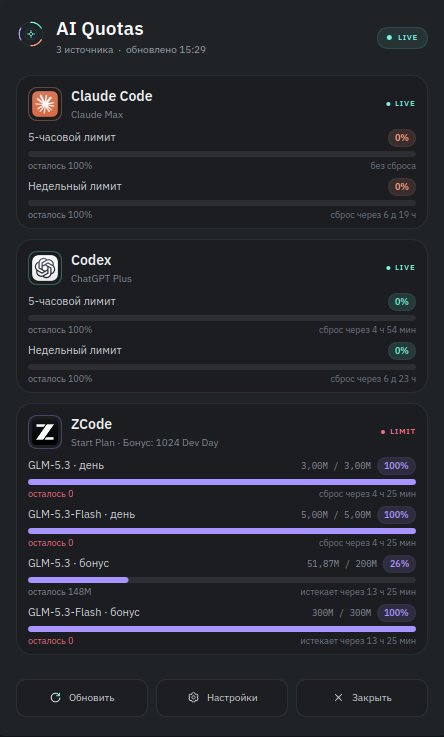
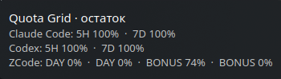

# Quota Grid

Виджет KDE Plasma 6, который собирает лимиты локально установленных AI-инструментов и показывает их прямо в панели. Поддерживаются 5-часовые и недельные окна Claude Code и Codex, а также дневные и бонусные пакеты ZCode. Обновление идёт в фоне через `systemd --user`, поэтому цифры остаются актуальными, даже когда попап виджета закрыт. При старте нового окна лимита приходит системное уведомление KDE.

> Версия 1.0.0. Проект использует локальные сессии и неофициальные usage-endpoint'ы, поэтому поведение провайдеров может меняться без предупреждения.

## Возможности

- Компактный индикатор в панели: капсула с фирменными значками инструментов и тонкими кольцами использования.
- Попап-дашборд с карточками Claude Code, Codex и ZCode, шкалами, процентами и временем до сброса.
- Для ZCode показываются реальные токен-пакеты по моделям, включая отдельные бонусные пакеты и срок их действия.
- Статусы `LIVE`, `LOW`, `LIMIT`, `AUTH`, `PAUSED`, `STALE`.
- Кнопки обновления, открытия настроек и закрытия попапа.
- Автообновление раз в 5 минут (интервал настраивается).
- Уведомление при появлении нового окна лимита, даже если попап закрыт.

## Как это выглядит

<p align="center">
  
</p>

<p align="center"><sub>Попап: карточки провайдеров, проценты, время сброса и отдельные бонусные пакеты ZCode.</sub></p>

<p align="center">
  
</p>

<p align="center"><sub>Подсказка компактного индикатора при наведении в панели Plasma.</sub></p>

## Совместимость

Виджет рассчитан на **Linux с KDE Plasma 6**:

- протестирован на Kubuntu 26.04, KDE Plasma 6.6.6, Wayland, 1920×1200;
- требуется Python 3.10+, `systemd --user` и `kpackagetool6`;
- для ZCode нужен `python3-cryptography`;
- для уведомлений нужен `notify-send` (пакет `libnotify-bin` в Debian/Ubuntu); без него остальная часть работает;
- для задуманной типографики желательны шрифты IBM Plex Sans и IBM Plex Mono, но без них QML использует системный fallback.

Ограничения совместимости:

- это виджет Plasma, а не GNOME/XFCE/Cinnamon; для них нужен отдельный порт;
- Plasma 5 не поддерживается;
- X11 не тестировался (используются стандартные QML- и Plasma-API, но оформление попапа проверялось на Wayland);
- интерфейс сейчас на русском языке;
- нужна обычная пользовательская сессия systemd и установленные, авторизованные приложения провайдеров.

На Fedora KDE, KDE neon, Arch и openSUSE с Plasma 6 должна работать та же связка, но эти дистрибутивы пока не тестировались. Названия пакетов с зависимостями отличаются; `install.sh` проверяет ключевые зависимости и подсказывает, чего не хватает.

## Установка

```bash
git clone https://github.com/dengabrielyan/quota-grid.git
cd quota-grid
./install.sh
```

Для Kubuntu/Ubuntu зависимости ставятся так:

```bash
sudo apt install python3 python3-cryptography libnotify-bin kpackagetool6 fonts-ibm-plex
```

Затем добавьте виджет через стандартный выбор виджетов Plasma или выполните:

```bash
./install.sh --add-to-panel
```

Скрипт устанавливает всё в домашний каталог пользователя и не требует `sudo`:

- `~/.local/lib/quota-manager` — backend;
- `~/.local/bin/quota-manager` — CLI;
- `~/.local/share/plasma/plasmoids/org.kde.quota-grid` — виджет;
- `~/.config/systemd/user/quota-manager.service` — фоновый сервис;
- `~/.local/share/icons/hicolor/scalable/apps/quota-grid.svg` — иконка.

Если сервис не нужен, используйте `./install.sh --no-service`: виджет продолжит обновлять данные при открытии попапа, но фоновых уведомлений не будет.

## Провайдеры

Приложение использует уже существующие локальные сессии:

| Источник | Что нужно | Что читается |
| --- | --- | --- |
| **Claude Code** | установленный и авторизованный `claude` | `~/.claude/.credentials.json` и OAuth usage endpoint |
| **Codex CLI** | установленный и авторизованный `codex` | официальный локальный JSON-RPC `codex app-server` |
| **ZCode** | ZCode Desktop с активной сессией z.ai | `~/.zcode/v2/credentials.json` и billing API |

Claude Code использует OAuth с ротацией refresh-токена. Quota Grid при необходимости обновляет access-токен и **атомарно** сохраняет новую пару в файл Claude Code, сохраняя остальные поля файла и права `0600`. Если сессия отозвана, выполните:

```bash
claude auth login
```

Для Codex при истечении сессии выполните `codex login`; для ZCode — войдите в приложение заново. В интерфейсе такие состояния показываются как `AUTH`.

## Использование

```bash
quota-manager status          # таблица из кэша, без сети
quota-manager status --json   # JSON (используется виджетом)
quota-manager refresh         # опросить все источники сейчас
quota-manager refresh --json  # JSON после обновления
quota-manager doctor          # диагностика источников и зависимостей
quota-manager notify-test     # проверить системные уведомления
quota-manager settings        # создать и открыть config.json
systemctl --user status quota-manager
journalctl --user -u quota-manager -f
```

Кнопка обновления в попапе также запускает `refresh`. Обычно её не нужно нажимать: сервис обновляет данные автоматически.

## Уведомления

После установки сервис уже работает. При появлении нового окна лимита он отправляет одно системное уведомление на инструмент, даже если попап виджета закрыт. Первый запуск только запоминает текущие окна и не создаёт ложных уведомлений.

Проверить системные уведомления:

```bash
quota-manager notify-test
```

KDE показывает такие уведомления как всплывающие окна и сохраняет их в истории в зависимости от настроек «Уведомлений» системы.

## Конфигурация

Создайте `~/.config/quota-manager/config.json`:

```json
{
  "refresh_interval_seconds": 300,
  "notifications": true
}
```

Интервал ограничен диапазоном 60–3600 секунд. После изменения интервала перезапустите сервис:

```bash
systemctl --user restart quota-manager
```

## Приватность

Данные не отправляются в сторонние сервисы. Приложение не содержит телеметрии. OAuth-токены никогда не попадают в кэш, журналы или вызовы виджета. Кэш и состояние имеют права `0600`, каталоги — `0700`.

В кэше хранятся только нормализованные значения квот, статусы и время сброса. Сообщения об ошибках проходят редактирование секретов перед записью в журнал.

## Ограничения

- Anthropic и ZCode не публикуют контракты именно этих usage-endpoint'ов; при изменениях на стороне сервисов провайдер может временно показывать `ERROR`.
- Codex app-server помечен как экспериментальный самим Codex CLI.
- ZCode поддерживает активный провайдер `z.ai`; корпоративные конфигурации bigmodel могут отличаться. У текущего тарифа Start Plan нет 5-часового или недельного окна, поэтому виджет честно показывает дневные лимиты и бонусные пакеты, а не выдумывает недоступные значения.
- OpenCode, Gemini CLI и другие инструменты не добавлены, пока у них нет доступного локального источника квот.
- Оформление попапа (без системной рамки, отступ 24 px от края) проверено на Plasma 6.6. На других версиях Plasma рамка может выглядеть иначе; функциональность виджета от этого не зависит.

## Удаление

```bash
./uninstall.sh          # удалить приложение, сохранить кэш
./uninstall.sh --purge  # удалить всё, включая кэш
```

## Разработка

```bash
python3 -m unittest discover -s tests -v
```

Тесты не обращаются к сети и не требуют реальных токенов. Они проверяют парсинг окон, выбор дневных и бонусных пакетов ZCode, редактирование секретов и детектор сбросов.

```text
quota_manager/                 Python backend и провайдеры
plasma/org.kde.quota-grid/     Plasma 6 plasmoid (QML)
docs/screenshots/              скриншоты интерфейса
systemd/                       user service
tests/                         unit-тесты парсинга и детектора сбросов
install.sh / uninstall.sh      установка в домашний каталог
```

## Логотипы

Иконки провайдеров взяты из локально установленных приложений Claude, ChatGPT/OpenAI и ZCode и используются только для идентификации соответствующих сервисов. Права на логотипы принадлежат их владельцам; проект не аффилирован с Anthropic, OpenAI или ZCode.

## English summary

Quota Grid is a KDE Plasma 6 panel widget that displays usage limits from locally installed AI coding tools (Claude Code, Codex, ZCode). It reads existing local sessions, refreshes quotas through a `systemd --user` service, and sends KDE notifications when a limit window resets. Requirements: Linux, KDE Plasma 6, Python 3.10+, `python3-cryptography` for ZCode, and authorized provider CLIs/apps. The UI is currently in Russian. Tested on Kubuntu 26.04 with Plasma 6.6.6 on Wayland; other Plasma 6 distributions should work but are not yet tested. Install with `./install.sh`, then add the widget to a panel. This is not a GNOME/XFCE widget and does not support Plasma 5.

## Лицензия

MIT.
